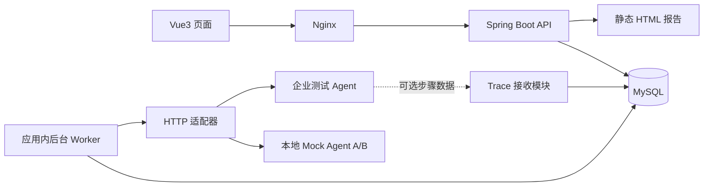

# AI Agent 评测与可观测性平台 Demo 初步开发计划

编制日期：2026-10-12；版本：v0.1；性质：开发规划，尚非已实现功能或实测成果。

## 1. 规划依据与目标

依据 `20261012启动方案/20261012启动方案` 中的《01 团队分工与课程实践计划》《02 产品需求文档 PRD》《03 技术需求文档 TRD》《04 企业试点与竞赛交付计划》及《交付说明》制定。

当前目录包含需求、技术与交付材料，未发现应用源码。建议从工程骨架开始，沿用原材料的 Java、Vue3、MySQL 技术路线。

本轮目标是可运行、可演示、可复查、可打包提交的申报 Demo：在同一套 20–30 条业务问题上评测一个 Agent 的 A/B 两个配置版本，完成评分、人工复核、改善与退化比较、失败证据查看，以及单文件离线 HTML 报告导出。

暂按原材料中的 2–3 名核心开发、5–8 人协作团队、11 月 4 日内部完成安排。团队实际投入、企业接口可用时间和正式提交要求尚待落实。材料中的班级节点为 11 月 5 日之前提交、11 月 6 日 16 时前班级汇总；本计划未独立核验最新通知，学校正式附件仍以实际通知为准。

本计划交付开发范围、排期、任务及验收口径，不表示系统已经开发完成。

## 2. Demo 场景与演示故事

默认选择“企业知识库客服 Agent”，包含政策问答、资料检索、一个只读业务查询工具。企业有明确场景时替换业务数据和适配器，尽量保持平台核心流程稳定。

首轮建议准备 25 条问题：常规问答 10 条、边界条件 5 条、信息不足或应拒答 5 条、工具查询 5 条。每条记录 case_id、输入、参考依据、检查点、适用规则、场景标签与来源。此分布为待评审建议，不是现有企业数据。

- A 版：基线配置。
- B 版：修改提示词、知识库或工具规则后的候选配置。
- 模拟演示中设计改善、退化、保持不变、无法判断及调用错误等情况，明确标记故障注入与模拟来源。
- 真实运行展示实际结果，不保证 B 版更好；若没有退化案例，可另用标注清楚的模拟案例展示定位流程。

3–5 分钟演示顺序：打开已发布问题集 → 查看 A/B 配置 → 启动或查看已完成批次 → 展示质量与覆盖率 → 打开一个退化案例 → 查看回答、评分依据和可用 trace → 人工复核 → 导出报告。

联网可用时展示真实接入；离线时使用本地 mock Agent 和保存的历史批次。历史记录应标明历史运行时间，模拟调用应标明模拟来源。

## 3. 首轮范围与取舍

### 3.1 P0：可提交 Demo 必須具备

| 需求 | 最小实现 | 验收结果 |
|---|---|---|
| FR01 项目与权限 | 本地账号、管理员/开发者/评审者角色、项目归属校验；允许预置账号 | 不同角色动作受限；跨项目访问被拒绝 |
| FR02 数据集 | 优先 JSONL 导入、行级错误、草稿预览、发布版本与内容 hash | 20–30 条可导入；重复 ID 可定位；发布后不能原地修改 |
| FR03 Agent 接入 | 一个统一 HTTP 适配器、配置快照、连接测试、能力标记；本地 mock 也走该契约 | 可运行 A/B；黑盒和有 trace 的能力显示准确 |
| FR04 运行批次 | 数据库任务表、后台执行、进度、取消、超时、有限重试、重启恢复 | 关闭页面不影响执行；重启不丢已有结果；重复提交不重复建批次 |
| FR05 评分复核 | 业务字段/要点规则、通过/失败/未知；人工复核附理由和历史 | 规则可解释；未判定不会当作失败；人工改判不覆盖旧记录 |
| FR06 版本对比 | 同数据集 hash、同评分版本按 case_id 配对 | 同时显示改善、退化、维持、不可比及对应分母 |
| FR07 观测详情 | 客户端总耗时、调用错误；有数据时显示 trace 树、Token 和已知成本 | 黑盒不生成虚构步骤；缺失 usage/价格时显示未知或已知部分 |
| FR08 报告导出 | 预览、内部/脱敏模式、单文件静态 HTML | 离线打开；结果与页面一致；包含版本、覆盖率、限制与案例 |

7 个逻辑页面沿用 PRD：首页、数据集、Agent 配置、批次详情、版本对比、trace 详情、报告预览。trace 可先做详情抽屉，配置和报告可使用简单表单及模板，减少页面建设成本。

### 3.2 首轮暂缓

节点采集 SDK、LLM 自动裁判及校准、定时回归、生产告警、多企业 SaaS、多模态、自动优化、Agent 编排器、复杂自定义仪表盘。以上分别按原 PRD 的 P1/P2 或后续扩展处理。

可观测性首轮实现接收和查看已有步骤数据；SDK 自动采集是后续能力。平台自身的请求日志、任务积压与 Agent 内部 trace 分开管理。

### 3.3 企业接入依赖与降级

10 月 14 日前确认企业测试接口、认证方式、数据授权范围、A/B 标识、是否提供 trace 和 usage。建议最迟 10 月 18 日确定真实接口是否能进入本轮主路径。

- 接口及时可用：接入一个真实 Agent，保留 mock 作为稳定性测试与离线演示基础。
- 接口未就绪：使用同契约的 mock A/B 完成 P0；报告和路演注明“模拟演示，企业接入待完成”。
- 只有历史结果：视时间增加结果导入，标明结果来源与缺失字段；不能将历史数据展示为现场运行。
- 企业只提供黑盒接口：展示输出、耗时、错误；节点定位使用独立标注的 mock 示例，企业数据页面显示观测缺失。

降级后可提交功能演示版，但不得将其写成已完成真实企业试点。

## 4. 技术架构与工程组织

采用模块化单体，建议 Java 21、Spring Boot 3.x、MyBatis-Plus、Spring Security、MySQL 8.x；前端 Vue3、TypeScript、Vite、Element Plus，图表需要时选 ECharts。具体依赖版本在开工兼容性检查后锁定，提交构建文件及前端锁文件。



任务状态落数据库，线程池默认并发 2；单 Worker 起步。页面先采用轮询获取进度，无须为首版引入 WebSocket、消息队列或分布式调度。Docker Compose 组织前端/API/MySQL，mock 可作为可选演示服务。

```text
agent-eval-platform/
  backend/        identity、dataset、agent、evaluation、observation、report
  frontend/       页面、组件、API 客户端
  contracts/      OpenAPI、JSON Schema、状态枚举、请求响应样例
  demo-data/      问题集、mock A/B 配置、明确标记的模拟 trace
  deployment/     Compose、Nginx、环境变量示例、迁移与备份脚本
  docs/           开发计划、接入指南、测试报告、操作说明、演示脚本
```

核心实体沿用 TRD：project/member、dataset_version/dataset_case、agent_config、evaluator_version、eval_run、eval_case/attempt、score/review、trace_step、report/audit。

优先冻结四类契约：问题集 schema、Agent 请求/响应、评分结果与状态、运行与对比 API。接口以 TRD 已列出的 `/api/v1` 路径为基线，前后端共用字段和错误码说明。

## 5. 必须在开发初期确定的口径

1. **版本可追溯。** 发布的问题集和 Agent/评分配置生成快照；运行保存 manifest。数据集或评分版本改变后，不能与原运行直接生成正式质量差值。
2. **执行与评分分开。** 请求成功不等于业务通过。任务保留成功、调用错误、平台错误、取消；评分保留待评、已评、未知、异常。已评结果另存通过或失败。
3. **指标有分母。** 通过率 = 通过数 / 已判定数；判定覆盖率 = 已判定数 / 计划样本数；全样本通过占比 = 通过数 / 计划样本数。分母为 0 返回空值。调用错误、取消、未知和评分错误另行列出。
4. **对比公平。** 正式配对质量统计仅使用两边都完成判定、同数据集和同评分版本的 case；同时列出不可比数量及原因。人工修订发生后记录结果修订点，导出的历史报告固定其评分记录清单与截止时间。
5. **成本诚实。** 缺 Token 或价格不填 0；成本按所有调用尝试累计并显示覆盖率。首版未启用 judge 时标记未启用；后续启用后单独记账。
6. **运行可恢复。** 创建运行具备幂等键；Worker 通过条件更新领取任务并使用 lease。过期任务按接口幂等能力恢复，不确定外部是否执行的请求转入待核对；取消停止领取新任务，保留已完成结果。
7. **证据可解释。** 无 trace 不判断工具调用正确性；无引用证据不判断忠实度。文本相似度不能替代业务正确性或忠实度。
8. **共用计算。** 核心指标由后端一次计算，页面与报告复用；前端仅做格式化展示。
9. **最小安全闭环。** 服务端执行项目鉴权；密钥独立配置且不进入导出；Agent 地址按允许范围配置；输入校验和 HTML 转义纳入关键测试。

## 6. 开发排期与阶段验收

下表为目标排期，按 2026 年日期执行；任务能否完成由阶段验收决定。

| 阶段 | 日期 | 开发任务 | 阶段出口 |
|---|---|---|---|
| M0 范围与契约 | 10/12–10/14 | 冻结一个场景；列出页面流程；确定 schema、接口和状态；准备 5 条样例；确认企业接入条件 | A/B mock 契约、需求清单、分工和开发环境可用 |
| M1 最小闭环 | 10/15–10/18 | 后端/前端/数据库骨架；基础权限；数据集发布；mock HTTP 调用；保存结果与基础评分；简版对比和 HTML 导出 | 用 5 条样例从导入跑到报告；25 条样本草案就绪；报告可离线打开 |
| M2 完整评测流程 | 10/19–10/25 | 20–30 条问题；批次进度、幂等、取消、恢复；人工复核；A/B 逐项比较；企业 HTTP 适配或明确降级 | 两版批次可执行；改善/退化/未知/调用错误表现正确；关键恢复测试通过 |
| M3 提交候选版 | 10/26–11/01 | trace 展示；耗时与成本口径；完整报告与脱敏；Compose；权限和端到端测试；企业或内部试用 | FR01–FR08 验收记录；部署说明、试用反馈、演示录屏；11/01 冻结功能 |
| M4 发布与提交包 | 11/02–11/04 | 仅修阻断缺陷；第二成员独立部署演示；整理源码、报告、证据、PPT 和申报附件 | 固定发布版本、完整交付包、备份演示材料及未完成项说明 |

关键依赖：数据 schema → 版本快照 → 任务执行与结果 → 评分 → 对比 → 报告。前端使用契约样例推进；数据准备、企业沟通和部署文档可同步开展。

10 月 18 日若最小闭环未完成，立即减少首轮外观设计、导入格式和适配种类；10 月 25 日若完整运行与对比仍不稳定，将余下时间集中于 P0 闭环和提交稳定性。仍不满足验收的功能应列为未完成，不能靠静态截图标成已实现。

## 7. 任务拆分与责任

岗位与原材料一致：A 产品/队长，B 后端，C 接入/链路，D 前端，E 评测数据，F 测试部署，G 企业试点。

| 任务包 | 负责人 | 首个可验收产出 | 依赖 |
|---|---|---|---|
| W01 范围、原型与验收 | A | 7 个逻辑页面流程、P0 清单、演示脚本初稿 | 无 |
| W02 工程与权限 | B | API 骨架、迁移脚本、本地账号、跨项目拒绝测试 | W01 |
| W03 问题集与规则样本 | E | 25 条草案、5 条先行样例、检查点与预期判定 | 场景确认 |
| W04 数据集和版本 | B | 导入错误、发布快照、不可变版本接口 | W02、W03 schema |
| W05 HTTP 与 Mock A/B | C | 统一适配器、连接测试、错误/未知/trace 样例 | Agent 契约 |
| W06 运行与恢复 | B | 持久化任务、进度、幂等、取消、重启恢复 | W04、W05 |
| W07 评分与复核 | B，E 定义口径 | 规则执行、理由、人工追加修订、指标公式 | W03、结果 schema |
| W08 页面与比较 | D | 数据集、配置、批次、配对案例及权限状态 | 契约样例先行，后接 W06/W07 |
| W09 Trace 与报告 | C、D 协作，B 负责聚合 | 可用步骤详情、缺失状态、离线 HTML | W06–W08 |
| W10 验收与发布 | F | 关键测试记录、Compose、备份恢复、独立演示 | M1 起持续进行 |
| W11 企业与提交证据 | G，A 统稿 | 接入边界、访谈、业务反馈、证据索引 | 全程并行 |

只有两名核心开发时，建议由一人承担 B+C，另一人承担 D；E/F 分别承担样本、验证和部署，A/G 合并协调。第三名开发优先接走适配与 trace，再协助报告，避免前后端互相等待。

## 8. 工时评估与范围控制

原材料按核心开发 2–3 人、每人每周约 10 小时、3 周估算 60–90 小时。以下重新拆分仍是粗估，需在 M0 根据成员经验修订：

| 工程包 | 核心开发估算 |
|---|---:|
| 工程、契约、鉴权与迁移 | 12–16 小时 |
| 数据集、配置与版本快照 | 12–16 小时 |
| 适配、任务执行与恢复 | 20–28 小时 |
| 评分、复核与版本对比 | 16–22 小时 |
| 页面、trace 详情与报告 | 22–30 小时 |
| 联调、部署与关键缺陷修复 | 14–20 小时 |
| 合计 | 96–132 小时 |

另建议预留约 20% 缓冲，核心开发总体约 115–160 小时；样本审核、企业访谈、申报材料和独立测试由协作成员另行安排。此估算不含企业等待时间，也不构成交付保证。

因此，原投入预算下完整 P0 有明显压力。应尽早锁定真实可投入时间，采用组件库、预置账号、JSONL 单格式、单 HTTP 适配器、规则与人工评分、轮询和模板报告，减少工程量。压缩后重新估算，不能默认 60–90 小时一定足够。

若仍缺工时，优先增加核心开发投入或明确缩小验收范围并记录偏离原 PRD；不以省略鉴权、结果持久化、指标分母或历史记录来换取表面完成度。

## 9. 测试与“可提交”门槛

### 9.1 必须通过的核心验证

- 项目权限：另一项目账号不能查看、修改、导出本项目数据。
- 数据集：缺字段、重复 case_id 显示具体行；发布版本不能原地修改。
- 任务：同幂等键同请求返回同批次；不同请求体冲突；取消、超时和 Worker 重启后状态可解释。
- 评分：通过、失败、待评、未知、评分异常的分母正确；数值 0 与缺失值区分。
- 对比：不同数据集/规则不能产生正式差值；同一批 case 同时显示改善、退化、维持和不可比。
- 观测：重复 span 不重复计数，乱序和缺父节点可显示不完整；黑盒无内部步骤。
- 成本：缺 usage/价格显示缺失；重试计入已知支出，不将未知记为免费。
- 报告：可断网打开、不依赖 CDN；用户内容正确转义；脱敏版本不包含密钥或未授权内容。
- 闭环：20–30 条样例运行 A/B → 评分复核 → 比较 → 查看案例 → 导出，结果可追溯。
- 部署恢复：第二位成员按文档启动、备份和恢复；恢复后可查看历史批次及报告。

使用 JUnit/Mockito 验证状态和公式，接口/集成测试验证 MySQL 持久化与权限，端到端检查验证真实用户操作。测试报告记录实际结果和未通过项。

### 9.2 性能目标与测试条件

沿用 TRD 作为待测目标：4 核 8 GB、预置镜像条件下第二成员 30 分钟内启动并完成 mock 评测；100 条、每条模拟响应 200 ms、并发 2 的任务在 5 分钟内完成。首次下载依赖或镜像时间另记。

TRD 的“10 万条 step、10 个并发只读、详情 P95 ≤ 2 秒”应在条件具备时专项测量；若本轮未完成，提交材料标为待验证。真实企业 Agent 耗时另报，不与平台查询指标混合。

## 10. 提交包与成果证据

建议提交包包含以下内容；正式申报文件另按学校模板填写。

1. **可运行源码**：后端、前端、依赖锁定、数据库迁移、明确的发布版本。
2. **部署文件**：Compose、配置示例、启动/停止/重置说明、备份恢复步骤；秘密配置不进入包内。
3. **演示数据**：20–30 条自建或获准脱敏问题、mock A/B、模拟 trace、历史演示批次。
4. **结果报告**：至少一份带版本与来源说明的离线 HTML 对比报告。
5. **使用文档**：安装、账号角色、导入格式、Agent 接入、评分口径及已知限制。
6. **测试证据**：验收记录、关键异常复现、实际部署环境和未完成项。
7. **演示材料**：3–5 分钟录屏、操作脚本、离线回退方法；录屏与提交版本一致。
8. **竞赛资料**：PPT、项目申报书、汇总表及访谈/试点证据索引。无真实企业试点时明确说明当前仅完成功能演示。

## 11. 启动时需要落实的信息

本计划按上述假设可直接启动。启动会应落实：

- 实际开发成员及每周可投入小时，B/C/D 的主责与备份。
- 企业场景、测试接口、A/B 版本和数据使用范围；只有黑盒能力时也可接入。
- 演示电脑能否运行 Docker Desktop、是否必须断网演示、是否还需在线体验地址。
- 学校或班级最终截止时间、正式附件和源码/视频等提交格式。

第一开发动作建议为：确定 5 条带预期结果的样例与 HTTP/schema 契约，建立工程骨架，然后完成一条真实贯穿前后端和数据库的最小评测闭环。M1 的报告先采用简版模板，后续迭代补齐视觉和证据展示。
